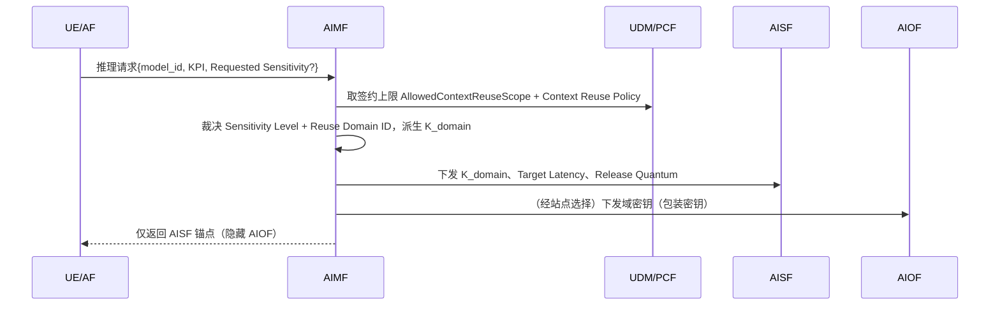
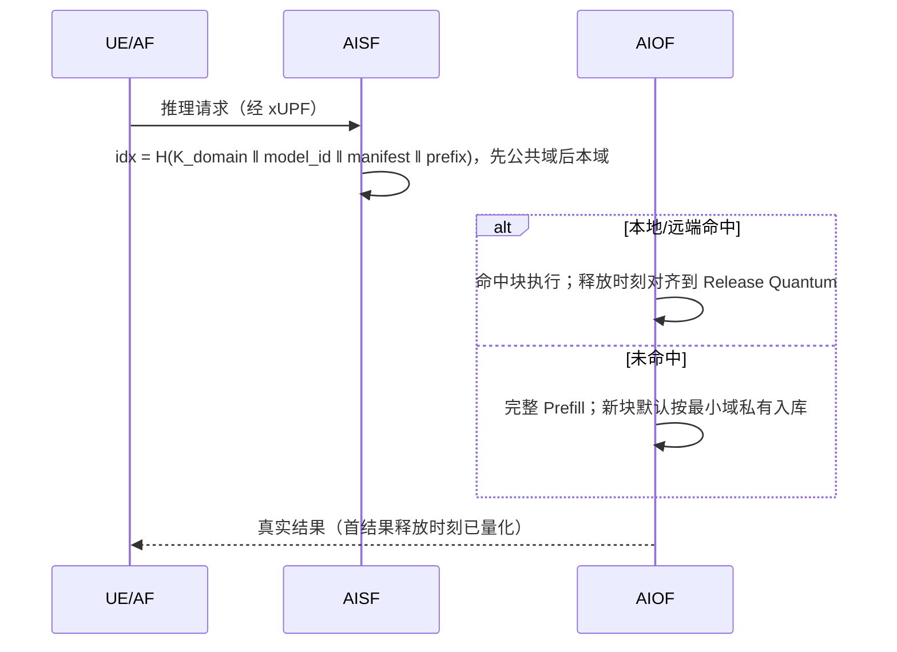
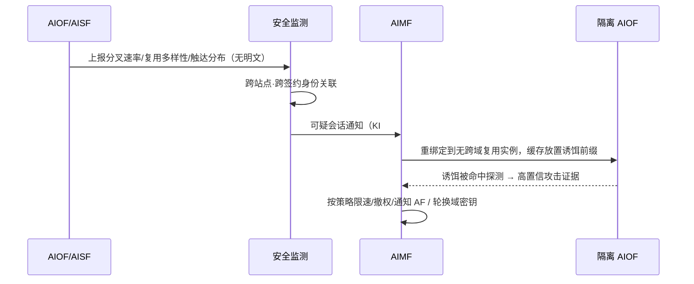

# 专利 IDEA 构想思路（V2 · 按评审改进重构）

**暂定名称**：一种跨计算站点的可复用 AI 推理上下文的运营商可控复用与时序侧信道防护方法、系统及装置

**标准方向定位**：
*Support of secure, operator-controlled reuse of AI inference context (e.g. KV cache) across Computing Sites for network AI inference service, with protection against inference-context timing side channels.*

**与既有材料的关系**：本版是在《KV Cache防侧信道攻击解决方案思路-qwen》（V1 五层防御）基础上，依据《专利评审报告（含改进建议）》重构后的构想。核心变化：**防护来源从"雪崩哈希/延迟对齐"改为"按复用域的秘密密钥隔离"；反制从"返回假数据"改为"隔离真实实例+诱饵取证"；威胁模型补齐域内攻击者、存在性泄露与标准自身泄露面。**

---

## 0. 一句话构思

> 在网络 AI 推理会话建立时，由网络管理功能（AIMF）依据**签约上限 + 运营商策略 + 应用声明**裁决该会话"推理上下文"的**复用域**，并把**与签约绑定的域密钥注入上下文的内容寻址索引**——使不同域之间哪怕前缀完全相同也互不可命中；再以**有界的释放时刻量化**隐藏缓存层级、对消费者**隐藏具体执行实例（AIOF）**、对指标暴露与计费**去相关**；对疑似探测则**静默重绑定到结果真实的隔离实例并放置诱饵前缀取证**。

安全与复用由此解耦：**公共上下文完全开放，私有上下文在密码学意义上"不存在于他人的查找空间"**，而不是靠加延迟或硬隔离。

---

## 1. 要解决的问题

### 1.1 问题来源

母方案（KV Cache CDN 构想 V3）把 KV Cache 从引擎内一次性私有内存，变为跨端-边-云、内容寻址、可全局复用的资产。共享即带来侧信道：

- **Hit（本地显存读 KV）≈ 10–100ms**；**Miss（跨节点拉取 / 重算 Prefill）≈ 数百ms–5s+**；
- 攻击者逐 Token 微调 Prompt、高精度测量首字时延（TTFT），即可像"盲打"一样逐字节恢复他人私有前缀（私有 System Prompt、企业机密 RAG、对话历史）。该攻击已有学术实证（NDSS 2025 类工作），且代价低至约 10² 次请求/Token。

### 1.2 三类既有防御都不可接受

| 路线 | 不可接受的原因 |
|---|---|
| 严格租户隔离 | 摧毁 CDN 复用价值，公共模板也无法跨租户共享，成本飙升 |
| 全局延迟注入（对齐到 5s） | 合法体验崩溃；随机注入可被多次采样取中位数滤除 |
| API 网关限流 | 挡不住分布式僵尸网络的慢速探测 |

### 1.3 6G 既是放大器、也是最优解决场域

- **放大**：6G 增强的 QoS 监测、网络状态/计算指标暴露、通信-计算协同的站点选择，使攻击者能更精确地分离网络时延与计算时延，并可能从"指标、选择结果、计费"等多个旁路读出缓存状态；
- **机会**：6G 架构中每次推理请求都绑定**可归属的签约身份**，且 AIMF/AISF/AIOF 的功能划分、会话信息元素（IE）尚未收敛（大量 FFS）——既存在标准空白，也提供了"网络级裁决 + 密钥下发 + 跨站协同"的现成落脚点。

### 1.4 本构想要回答的核心矛盾

> 如何在**不牺牲公共上下文复用收益、不恶化合法时延 SLA、不依赖用户打标签**的前提下，让私有推理上下文对域外攻击者在密码学上不可观测，并把泄露界定在可度量范围内（bound the leakage）。

---

## 2. 威胁模型（本版重构）

### 2.1 资产

1. 他人推理前缀的**内容**（系统提示、RAG 文档、工具定义、对话历史、个人数据）；
2. **"某前缀 / 某文档存在或被某人查询过"这一事实本身**（成员关系 / 存在性隐私）——即使读不到内容，也可能据此推断并购、裁员、重组等事件。

### 2.2 攻击者

| 代号 | 攻击者 | 能力 |
|---|---|---|
| **A1** | 已签约 UE 上的恶意应用 | 经 AIMF 授权、合法调用推理服务，可自测时延 |
| **A2** | 经 NEF/暴露框架接入的恶意或被攻破 AF | 可订阅网络/计算指标，无需自测即可读状态 |
| **A3** | 大量 SIM/UE 组成的分布式慢速探测群 | 规避单账号限流，长期汇聚大样本 |
| **A4**（新增） | **同租户内低权限 / 被攻破账号** | 持有本租户域密钥，可探测本租户其他部门/员工/会话的内容与存在性 |

### 2.3 泄露信道

| 信道 | 机理 |
|---|---|
| **C1** | TTFT 主信道：Hit/Miss 的首结果时延差 |
| **C2** | 网络辅助测量：用暴露的 N3/N9/N6、E2E 时延减去网络部分，得到更纯的计算时间 |
| **C3** | 计算指标暴露：TTFT、ms/token、"负载→处理时间映射"随缓存状态变化 |
| **C4** | 选择结果泄露：回传的 AIOF 地址 / DNAI 随命中而变 |
| **C5** | 计费/用量泄露：命中折扣计费、消耗 token 上报反映命中 |
| **C6**（新增） | 网关查询时延、直连 Endpoint 的握手/RTT 与失败路径差异，在业务字节之前泄露节点身份 |

### 2.4 攻击者预算与范围边界

- 所有安全结论都相对 **(时间窗 T, 查询预算 Q)** 表述（例如 T=30 天内最多 Q 次请求）；
- **不在范围**：SHE 内特权攻击者、物理侧信道（功耗/电磁）——归平台安全与 TEE；
- **部署范围（首期）**：单 PLMN 内、运营商完全控制的多个 SHE 计算站点之间；跨 PLMN/跨第三方云留作后续增强。

---

## 3. 总体设计原则

| 原则 | 含义 |
|---|---|
| **默认私有（private-by-default）** | 新生上下文块先按最小域（会话/用户）私有入库，达抗操纵条件才提升共享 |
| **防护来自密钥，而非哈希雪崩或延迟** | 跨域不可观测的唯一来源是域密钥的秘密性；SHA-256 只是索引构造构件 |
| **分级而非一刀切** | 公共内容完全开放，防御资源集中在私有/高敏内容 |
| **有界对齐，不承诺"彻底"** | 释放量化只隐藏层级/位置；hit/miss 的隔离靠域密钥；用 mitigate / bound 措辞 |
| **不欺骗真实用户** | 反制只"隔离 + 诱饵"，对任何请求始终返回真实推理结果 |
| **运营商可控** | 复用域、密钥、策略由网络基于签约/策略裁决，全程可审计 |

侧信道成立的三个必要条件与本构想的破坏方式：

| 必要条件 | 破坏机制 |
|---|---|
| 可控性（微调输入精确制造碰撞） | **域密钥索引**：域外相同前缀也不碰撞 |
| 可观测性（观测 Hit/Miss 时间差） | **释放时刻量化 + 实例隐藏 + 去相关** |
| 可推断性（从观测推断目标） | **隔离实例 + 诱饵前缀**：探测一无所获且留下证据 |

---

## 4. 技术方案：六大机制

### 机制一：层级化复用域 + 默认私有

**复用域层级**（由宽到窄）：

```
Global（公共）  →  Tenant（租户）  →  Department/User-Group（部门/用户群）  →  User（用户）  →  Session（会话）
```

与母方案 A/B/C/D 模块对应：

| 模块 | 内容 | 默认复用域 |
|---|---|---|
| **A** 全局 System Prompt | 平台角色、安全规范 | Global（可跨租户） |
| **B** 标准 Tool Schema | 工具/函数定义、Agent 模板 | Global / 业务线 |
| **C** 租户 RAG 文档 | 私有知识库 | Tenant / Department；不跨租户 |
| **D** 对话历史 | 多轮动态累积 | Session / User；随会话移动 |

**默认私有与抗操纵提升**：

- 新块先按 Session/User 私有入库，由后台"租户熵 + 前缀树拓扑"自动评估**推荐等级**；
- 提升到跨租户域必须满足抗"投毒式提升"条件：**不同签约主体数 ≥ N，且来源/时间具有多样性**——攻击者无法靠制造共享度诱导升级；
- 最终等级由 AIMF 依据签约上限、PCF 策略与应用声明**裁决**（自动分级只作推荐，不作终局）。

**新增的策略/签约要素**：

- UDM 签约上限：`AllowedContextReuseScope ∈ {None, Session, User, Tenant, Global}`；
- PCF 策略：`Context Reuse Policy`（默认等级、L0 白名单、升降级规则、保留期）；
- 请求可携带 `Requested Sensitivity`（应用对自身系统提示/RAG 的声明，可选）。

### 机制二：域密钥注入内容寻址索引（核心承重机制）

**索引构造**：

```
idx = H( K_domain ‖ model_id ‖ compatibility_manifest ‖ token_prefix )
```

- `K_domain` 由 AIMF 在会话建立时按裁决的复用域派生（沿 **AKMA / 签约绑定密钥**思路），下发给 AISF / AIOF；
- Global 公共域使用全网公共密钥；Tenant 及以下使用租户/部门/会话各自密钥；
- **查找顺序**：先查公共域，再查本域。域外攻击者即使构造出与受害者**完全相同**的前缀，因不知 K_domain，索引不同、**无法命中**。

**为什么 V1 的"雪崩哈希"必须被替换**：

- 攻击不依赖"梯度"，攻击者每次提交完整候选前缀做**精确匹配**；
- 雪崩只保证"不同输入无关"，不阻止"相同输入匹配"；全局公开/可推导的 Salt 等于没有盲化；
- 因此**安全来源是 K_domain 的秘密性，SHA-256 仅作为索引哈希构件（从属点）**。

**密钥驻留安全**：AIOF/AISF 需持有大量域密钥 → 以 **HSM/TEE 内包装密钥（envelope wrapping）** 下发，索引计算在受保护环境进行，单节点被攻破不暴露全部租户。

### 机制三：不触发重算风暴的域密钥轮换（新专利点）

**问题**：直接轮换 K_domain 会使该域全部已缓存块不可寻址 → 大规模强制重算（算力尖峰），导致生产中不敢轮换。

**方案：版本化域密钥 + 块级惰性重封装**

- 索引引入 `key_version`；旧块在**被访问时**用旧密钥验证、用新密钥重封装索引（**数据块不动、不重算**）；
- 未访问块由后台按热度渐进迁移；轮换期间新版本双读、写入走新版本；
- 对查询方只暴露统一接口。

**效果**：密钥轮换与 KV 重算解耦，轮换不引起算力尖峰；该行为在信令/索引中可观测（`key_version`、双读），易取证。

**生命周期耦合**：签约撤销 / 订户许可撤回 → 域密钥销毁或轮换 → 旧块不可寻址并按留存策略回收（借 KI#21"许可撤回即删"原则）。

### 机制四：有界释放时刻量化 + 网关侧归一化

**释放时刻量化（隐藏层级）**：

- AIMF 下发 `Target First-Result Latency` 与 `Release Quantum`（如 50ms 桶）；
- AIOF/AISF（或 xUPF 的业务特定功能）把首结果**释放时刻对齐到量化桶**，使"本地命中 / 远端命中 / 同站热迁移"不可区分；
- **保护边界如实定义**：该机制只隐藏位置/层级与站点负载，**不单独承诺隐藏 hit/miss**——私有内容的 hit/miss 隔离已由机制二保证（跨域根本不命中），故无需把 10ms 对齐到 5s。

**网关侧归一化（补 C6）**：

- `RouteQuery → RouteGrant` 的查询时延、授权失败/未命中的响应结构与时延全部同构；
- 对 L1+ 会话，消费者**只拿到 AISF 锚点地址，不暴露具体 AIOF**；AIOF 切换在 AISF 之后完成（补 C4）。

**L3 高敏的恒定执行**：

- 以策略标志 `Constant-Latency Execution Required` 触发，AIMF 选择登记了该能力的 AIOF；
- 实现方式（影子计算 / TEE / 固定批次填充）留给实现；计费按完整计算计价；启用比例由运营商策略决定（不写死 <1%）。

### 机制五：隔离实例 + 诱饵前缀（替代"返回假数据"）

**检测**（不含明文、低开销）：

- AIOF/AISF 上报每域的前缀树**深节点分叉速率**、复用多样性比、同一前缀被不同签约身份触达的分布等"安全相关数据"；
- 安全监测功能跨多站点、多签约身份关联，识别 A3 分布式探测与 A4 域内探测。

**静默响应（始终返回真实结果）**：

1. 经安全响应框架（KI#7.3 的"重定向"语义）把可疑会话**重绑定到"无跨域复用"的隔离 AIOF**——结果真实，仅失去共享收益、性能略降 → **误报不伤害合法用户**；
2. 在其可见缓存中放置**诱饵前缀（canary）**；诱饵一旦被命中探测，即获得**高置信攻击证据**；
3. 证据确认后按策略：限速 / 撤销授权 / 通知 AF；相关公共块按需降级或轮换域密钥。

**与 V1 的区别**：不再向已认证用户返回伪造推理结果（与 KPI/可信 AI/误报责任/合法监听冲突）；高交互蜜罐仅作为对"已确认恶意身份"的可选威胁情报实施例，不服务任何真实业务。

### 机制六：暴露 / 选择 / 计费去相关（C2–C5）

| 旁路 | 约束 |
|---|---|
| **指标暴露 C2/C3** | 启用跨租户复用的站点只允许**抽象化暴露**（#22.9 Variant A/E、#22.15）；若提供 TTFT、ms/token，须"聚合窗 ≥ T、按服务等级而非单节点、限频"；"负载→处理时间映射"只能基于**与缓存状态无关的保守（按未命中）模型**生成 |
| **选择结果 C4** | 对消费者隐藏 AIOF/DNAI，只给 AISF 锚点 |
| **计费 C5** | 对外按**逻辑 token 统一计价**，命中节省仅在运营商内部核算；用量报告按时间窗聚合 |

> 机制六是相对纯学术防御方案最有说服力的增量——它处理的是 **6G 标准自身在研方案引入的泄露放大器**，也是 SEP 布局的富矿。

### 横切：完整性 / 迁移安全 / 合法监听 / 留存

- **防投毒**：公共共享块由生产 AIOF 签名/带完整性标签；迁移链路提供机密性、完整性、重放保护；
- **迁移安全**：上下文迁移链路只在同一复用域内建立，跨域须重新派生密钥、重新加密；
- **合法监听（LI）与留存**：声明上下文块是用户内容的**派生物、非通信内容替代副本**，对接 TS 33.126；会话/许可结束后按策略删除；
- **漫游**：首期单 PLMN；漫游沿用计算漫游 HR-SBO，复用域不跨 PLMN（除非运营商间协议）。

---

## 5. 与母方案部件 / 6G 网元的映射

| 本构想机制 | 母方案（V3）部件 | 6G 网元 / 挂点 |
|---|---|---|
| 复用域裁决、密钥派生、策略/签约 | ① 全局网关 | **AIMF**（+ UDM 签约、PCF 策略） |
| 上下文索引、锚点、释放对齐 | ② KV 目录 | **AISF**（AI context correlation & caching management） |
| 上下文块存储与执行、恒定执行 | ⑤⑥⑦、⑩ | **AIOF**（部署于 SHE 计算站点） |
| 公共上下文登记 | ⑤ / AIRF | **AIRF** |
| 释放时刻整形 | ⑨ WAN 加速层 | **xUPF 业务特定功能 / SmartNIC** |
| 探测检测与重绑定 | ①② + ⑫ 遥测 | AIOF/AISF 上报 → **安全监测（KI#7.2/7.3）** → AIMF 重绑定 |
| 计费去相关 | — | SA5 计费/OAM |

**抽象对象中立**：进标准/主权项统一称为"**可复用 AI 推理上下文（Reusable AI Inference Context, RAIC）**"，NOTE 中举例 "e.g. KV cache of transformer-based models"，不绑定具体模型结构，也不越入"应用层实现（3GPP 不管辖）"。上下文块存储放在 AIOF/AISF（KI#19），**不借 KI#21 数据框架承载**。

---

## 6. 关键流程构想

### 6.1 流程一：带复用域的推理会话建立



### 6.2 流程二：请求执行与释放对齐



### 6.3 流程三：探测检测—隔离—诱饵取证



---

## 7. 预期效果（以可复核目标值表述）

| 维度 | 目标值（目标，非承诺） | 度量方式 |
|---|---|---|
| 攻击者区分优势 | 在预算 (T, Q) 下 `Adv = |Pr[判 Hit] − Pr[判 Miss]| ≤ ε` | 给定 A1–A4、C1–C6 的攻击模拟 + KS 检验 |
| 公共上下文复用 | 公共（Global 域）上下文保持开放；**L0 可复用 token 占比**按业务重叠度实测 | 工作负载画像下统计 |
| 合法用户时延 | 释放量化引入的 TTFT 中位开销小（人类无感区间）；L0 公共流量零附加 | TTFT 分布对比 |
| 检测开销 | 复用既有前缀树计数器，无额外逐串比对；检测/整形可由 SmartNIC 卸载 | 资源占用测量 |
| 密钥轮换 | 轮换不引发重算算力尖峰 | 轮换窗口 GPU 利用率 |
| 误报安全 | 误判用户仍获真实结果，仅失去共享/略降性能 | 红队误报演练 |

> 说明：V1 中"复用率 ≥95%""TTFT +≤5%""30 天 80% 不可区分"等无测量前提的数字不再直接使用；正式数据须在**固定工作负载（跨租户重叠度、A/B/C/D 与长上下文占比）+ 明确攻击者预算**下测得。

---

## 8. 技术保护点（专利族构想）

围绕**一个统一发明构思**（复用域裁决 + 域密钥索引 + 释放量化 + 实例隐藏 + 去相关）布局：

| 层级 | 保护点 | 对应机制 |
|---|---|---|
| **核心独立权项** | 跨计算站点的可复用推理上下文运营商可控复用与侧信道防护（方法/系统/装置/介质） | 一~四、六 |
| 核心从属 / 平行 | **不触发重算的域密钥版本化轮换** | 三 |
| 防御性 | 隔离实例 + 诱饵前缀的探测取证 | 五 |
| 防御性 | 指标暴露/选择/计费去相关 | 六 |
| 防御性 | xUPF/SmartNIC 的释放时刻整形 | 四 |
| 防御性 | 自动分级推荐与裁决、分级准入/驱逐 | 一 |
| 从属 | 密钥包装/HSM 驻留、层级化域、完整性签名、同域迁移、单 PLMN 范围 | 二、横切 |

**可检测性（SEP 取证）**：核心特征尽量外显为可抓包/可观测的信令行为——AISF 锚点地址、释放时刻量化粒度、`decision` 字段、资源重绑定、计费聚合、`key_version` 双读；域密钥本身不可见，但其外显行为可举证。

---

## 9. 与 V1（qwen 五层）的差异对照

| 主题 | V1 观点 | V2 观点 |
|---|---|---|
| 跨域防护来源 | 语义+雪崩双重哈希"破坏梯度" | **域密钥命名空间隔离**；雪崩只是索引构件 |
| 时序对齐 | Hit 对齐到 ~100ms，"攻击彻底失效" | 释放量化**仅隐藏层级**；hit/miss 靠域隔离 |
| 反制 | 静默蜜罐返回**伪造数据** | **隔离真实实例 + 诱饵前缀取证** |
| 分级 | 100% 自动、无需用户 | 自动**推荐** + 声明 + 运营商**裁决**，默认私有 |
| 攻击者 | 跨租户（A1–A3） | 增加 **A4 域内攻击者** |
| 信道 | TTFT（C1） | 增加 **C2–C6**（含标准自身放大器） |
| 密钥轮换 | 未涉及 | **版本化惰性重封装**，不引发重算风暴 |
| 指标 | "复用率≥95%"等承诺 | 区分优势 Adv/KS + 负载与预算下的**目标值** |

---

> 本文件为专利 IDEA 构想思路（V2），非技术交底书、非权利要求书；量化内容为目标/示例值。下一步可在此基础上：① 完成 SafeKV 方向穷尽式检索并锁定区别特征；② 再进入正式交底书撰写。
