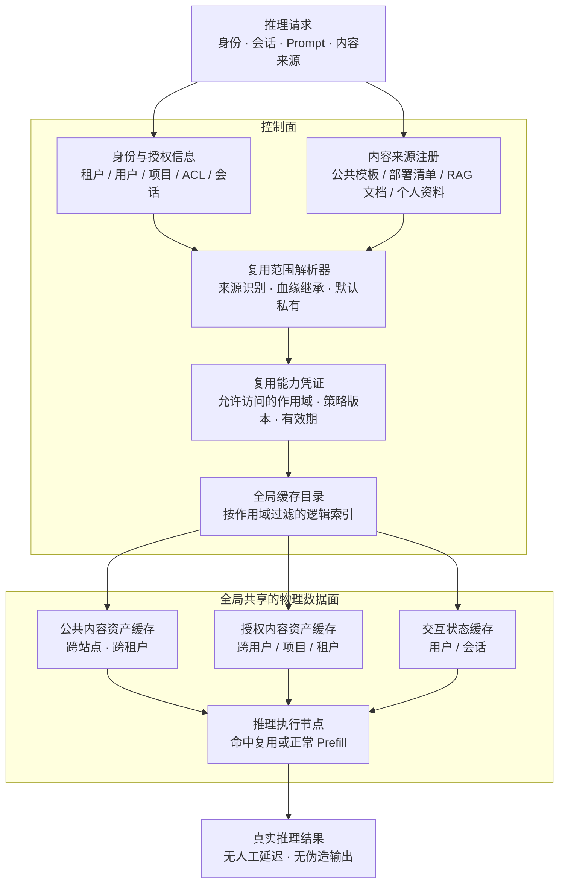
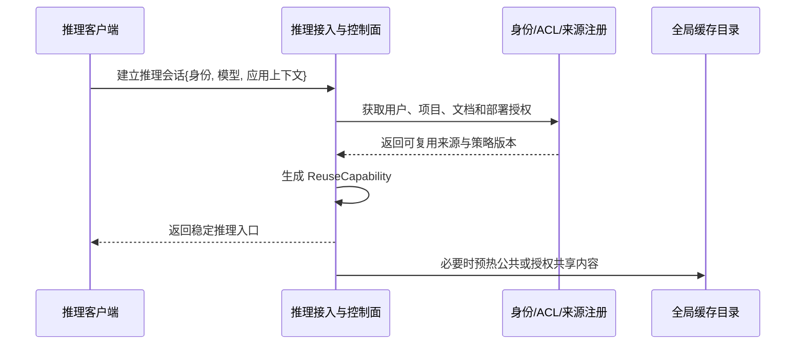
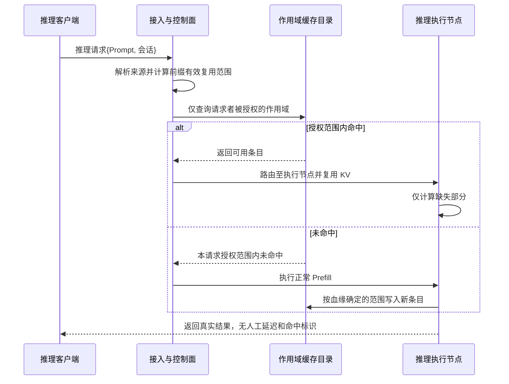

# 跨站点、跨租户/用户、跨会话 KV Cache 全局复用的侧信道防护解决方案报告

**方案名称**：来源感知的作用域复用（Provenance-Aware Scoped Reuse，PASR）  
**核心机制**：双平面缓存、前缀血缘继承、授权后查找  
**文档日期**：2026-11-10  
**文档性质**：技术解决方案报告

---

## 摘要

KV Cache 从单机显存走向跨站点、跨租户/用户、跨会话复用后，缓存命中与未命中之间的时间差会形成新的侧信道。攻击者可以逐 Token 构造候选前缀并测量响应时间，从而推断其他租户或用户的私有前缀、文档内容及上下文存在性。

本报告首先给出一个不可回避的技术边界：**如果攻击者与受害者共享同一缓存查找空间，命中又显著快于未命中，并且命中后不进行完整重算或最坏情况延迟对齐，那么缓存状态必然可通过时间被观测。** 因此，不可能在保留全部私有内容任意跨租户复用收益的同时，又完全不牺牲时延并彻底消除时序泄露。

为获得可工程落地的安全与性能平衡，本报告提出“来源感知的作用域复用”方案：

1. 将缓存划分为**内容资产平面**与**交互状态平面**，分别管理平台级/项目级可共享内容和用户交互状态；
2. 根据现有身份、ACL、部署清单、文档来源和会话关系，自动确定每段内容的复用范围，无需用户逐请求标注；
3. 让 KV 的可见范围沿前缀血缘自动收窄，避免公共前缀后的私有内容被错误放入共享空间；
4. 请求只能查询自身有权复用的缓存空间，未授权缓存是否存在不参与其执行过程；
5. 全局共享物理缓存、目录、站点和传输设施，但按授权作用域隔离逻辑查找空间；
6. 不注入固定延迟、不重复执行已有 Prefill、不返回伪造结果，使命中路径保持原有性能。

该方案保留公共内容的全局复用、授权内容的跨用户/跨租户/跨站点复用，以及个人内容的跨会话复用；仅放弃无法安全保留的“未授权私有内容之间的复用”。

---

## 1. 背景与问题定义

### 1.1 KV Cache 全局复用的收益

在长上下文、多轮 Agent、RAG 和企业知识库场景中，不同请求往往包含相同或部分相同的前缀，例如：

- 平台公共 System Prompt；
- 工具定义与 Agent 工作流模板；
- 企业级部署提示词；
- 公共知识库和共享文档；
- 同一用户反复使用的个人资料；
- 同一会话或同一用户跨会话的对话历史。

复用这些前缀对应的 KV Cache，可以避免重复 Prefill，降低首 Token 时延、GPU 算力消耗和跨站点部署成本。

当复用范围从单节点扩展到跨站点、跨会话、跨用户乃至跨租户时，统计复用机会进一步增加，但缓存也从“引擎内部状态”变成了“多主体共享状态”。

### 1.2 侧信道攻击原理

典型情况下：

- 本地缓存命中只需读取 KV 并开始 Decode；
- 远端缓存命中需要跨站点拉取或调度；
- 缓存未命中需要执行完整或增量 Prefill。

三者之间存在可观测的时间差。

攻击者可以构造：

```text
候选前缀 + 第 1 个候选 Token
候选前缀 + 第 2 个候选 Token
候选前缀 + 第 3 个候选 Token
……
```

如果攻击者请求与受害者私有前缀共享缓存状态，则命中与未命中的时间差会泄露哪个候选前缀曾经出现。反复迭代后，攻击者可能恢复私有 System Prompt、RAG 文档、对话历史等内容。

除内容外，以下事实同样可能具有敏感性：

- 某文档是否存在于平台；
- 某用户是否查询过某个主题；
- 某项目代号是否出现过；
- 某共享前缀最近是否被访问。

### 1.3 现有直观手段的不足

| 手段 | 主要问题 |
|---|---|
| 全部按租户隔离 | 公共内容也无法全局复用，损失大量安全复用收益 |
| 全局命中延迟补齐 | 合法用户命中体验显著下降 |
| 随机延迟扰动 | 大样本统计可能滤除噪声，且没有解决共享查找空间问题 |
| 全局哈希或加盐 | 如果攻击者使用相同函数和相同盐，相同前缀仍会发生精确匹配 |
| 依据访问热度自动公开 | 多租户访问不等于内容可以公开，可能泄露共同使用的机密资料 |
| 仅依靠攻击检测 | 检测存在漏报和误报，不能替代基础隔离 |
| 返回伪造结果 | 影响服务正确性，并可能伤害被误判的正常用户 |

---

## 2. 技术边界与设计目标

### 2.1 不可回避的技术边界

如果同时满足以下条件：

1. 攻击者与受害者复用同一份缓存；
2. 攻击者可以提交任意候选前缀；
3. 命中显著快于未命中；
4. 命中后不重算，也不等待至未命中耗时；
5. 系统立即返回正确结果；

则攻击者必然能够通过执行时间判断候选前缀是否命中。

因此，对任意私有数据而言，以下三个目标不能同时完全成立：

- 任意跨租户复用；
- 命中路径性能不下降；
- 缓存状态完全不可观测。

本方案不试图用扰动或哈希绕过这一边界，而是改变攻击者能够影响的缓存状态。

### 2.2 方案目标

本方案追求：

1. **保留安全复用收益**：公共、授权共享和个人范围内的 KV 仍可高效复用；
2. **正常体验不主动劣化**：不增加人工等待，不因安全机制重新计算已命中的 KV；
3. **不依赖用户逐请求配合**：复用范围从系统已有身份与内容来源自动推导；
4. **切断未授权时序预言机**：未授权缓存的存在与否不影响攻击者请求的执行路径；
5. **支持跨站点部署**：逻辑复用范围隔离不妨碍物理基础设施全局共享。

### 2.3 非目标

本方案不承诺：

- 任意私有内容均可跨租户复用；
- 隐藏所有共享资源负载和排队信息；
- 防御已控制受害者账号的攻击者；
- 防御运营商内部特权攻击、功耗或电磁等物理侧信道；
- 隐藏同一授权集合内部所有成员的访问活动痕迹。

---

## 3. 总体设计：双平面缓存与授权作用域

### 3.1 核心安全不变量

本方案的基础安全不变量为：

> **对于请求者 r 和缓存条目 e，只有 r 属于 e 的授权复用范围、授权策略仍然有效，并且 r 有权访问 e 的全部上游来源时，e 才允许影响 r 的查找、路由、计算和返回路径。**

如果请求者无权复用某个条目，则该条目：

- 不参与该请求的缓存查询；
- 不改变该请求的路由；
- 不改变该请求的 Prefill 范围；
- 不通过响应字段、错误或计费暴露；
- 原则上不应通过共享缓存容量驱逐形成明显探测接口。

在这一条件下，攻击者测量自己的响应时间，无法直接判断受害者条目的存在性。

### 3.2 总体架构



物理上，公共、授权共享和私有条目可以部署在同一套全局缓存基础设施上；逻辑上，它们处于不同的授权查找空间。

---

## 4. 双平面缓存设计

### 4.1 内容资产平面

内容资产是具有明确来源和生命周期的上下文，包括：

- 平台公共 System Prompt；
- 公共工具定义和 Agent 模板；
- 企业部署的共享提示词；
- 公共知识库和公开文档；
- 企业共享 RAG 文档；
- 跨部门或跨企业共享的项目资料；
- 用户个人知识库中的稳定文档。

其缓存生命周期尽量由以下事件驱动：

- 内容注册；
- 内容发布；
- 内容更新；
- ACL 或共享关系变化；
- 后台预热和容量回收。

而不是完全由“某个用户刚刚发起了请求”决定。

这样可以：

- 提前生成和分发热点 KV；
- 降低首个用户请求的冷启动时延；
- 减少缓存存在性与单个用户行为之间的直接关联；
- 支持公共内容全局复用和授权内容跨主体复用。

### 4.2 交互状态平面

交互状态包括：

- 用户即时输入；
- 多轮对话历史；
- Agent 中间状态；
- 工具返回的用户相关结果；
- 来源不明、无法证明可共享的原始 Prompt。

默认复用规则为：

| 可识别身份 | 默认复用范围 |
|---|---|
| 能识别最终用户 | 当前用户，可支持其跨会话复用 |
| 只能识别应用或租户 API Key | 当前会话，避免将不同最终用户混为一体 |
| 无稳定身份 | 当前请求或短生命周期会话 |

交互状态不会因为两个用户碰巧输入相同文本，就自动进入跨用户共享空间。

### 4.3 两类平面的复用价值

| 缓存类型 | 跨站点 | 跨会话 | 跨用户 | 跨租户 |
|---|---:|---:|---:|---:|
| 公共内容资产 | 是 | 是 | 是 | 是 |
| 授权共享内容资产 | 是 | 是 | 授权范围内 | 授权范围内 |
| 用户稳定个人内容 | 是 | 是 | 否 | 否 |
| 动态对话历史 | 是 | 用户级或会话级 | 否 | 否 |
| 来源不明原始 Prompt | 受限 | 默认可信身份内 | 否 | 否 |

---

## 5. 来源驱动的自动复用范围判定

### 5.1 不需要用户打标签，但不进行无依据的语义放开

系统可以利用现有信息自动判断复用范围：

- 当前租户、用户、应用和会话身份；
- RAG 文档 ID 与现有 ACL；
- 项目、部门和工作区成员关系；
- System Prompt 与工具模板的部署清单；
- 公共内容注册信息；
- 跨主体共享协议；
- 用户个人知识库归属；
- 会话上下文来源。

对于已经拼接成纯文本的 Prompt，可采用：

- 对已登记公共模板进行精确 Token 前缀匹配；
- 在请求者有权访问的内容注册表中进行精确来源匹配；
- 对无法识别的部分应用默认私有规则。

语义相似度、访问热度和租户数量可用于缓存调度，但不能单独用于扩大复用权限。

> **热度决定是否值得缓存，来源与授权决定谁可以复用。**

### 5.2 复用范围表示

每个缓存条目具有一个复用范围：

```text
ReuseScope =
    Public
  | Audience(授权主体集合, 策略版本)
  | Principal(用户)
  | Session(会话)
  | Request(单次请求)
```

典型映射如下：

| 内容来源 | 自动确定的复用范围 |
|---|---|
| 平台公共 System Prompt | Public |
| 公共工具模板 | Public |
| 企业私有部署提示词 | 企业或指定应用集合 |
| 部门共享 RAG 文档 | 部门成员集合 |
| 跨企业共享项目文档 | 项目授权成员集合 |
| 用户个人知识库 | 当前用户 |
| 多轮对话历史 | 当前用户或当前会话 |
| 来源不明的原始 Prompt | 最细可信身份；无法识别用户时为会话 |

### 5.3 默认规则

系统遵循：

1. 已证明为公共的内容，可以全局复用；
2. 已证明存在共享授权的内容，在授权集合内复用；
3. 个人来源内容，在个人范围内复用；
4. 无法证明可共享的内容，默认按用户或会话隔离；
5. 敏感内容扫描和异常信号只能收窄范围，不能单独扩大范围；
6. 访问次数和跨租户出现次数不能单独触发公开。

---

## 6. 前缀血缘继承：防止私有后缀进入共享空间

### 6.1 问题

一段 KV 不仅取决于最后一个内容块，还取决于之前的完整上下文。

例如：

```text
[A：公共 System Prompt]
    → [C：部门共享 RAG 文档]
        → [D：用户甲的私有提问和对话历史]
```

如果仅按最后一个内容块或租户标签确定复用范围，就可能把包含用户甲私有信息的 KV 放入部门共享空间。

### 6.2 继承规则

对任意前缀：

```text
EffectiveAudience(prefix)
    = 该前缀全部上游来源 Audience 的交集
```

即：

> **KV 条目的可见范围，继承全部上游来源中最严格的可见范围。**

示例：

| 上游内容 | 最终 KV 的复用范围 |
|---|---|
| 公共 A + 公共 B | Public |
| 公共 A + 部门文档 C | 部门 |
| 公共 A + 用户个人文档 C | 当前用户 |
| 公共 A + 部门文档 C + 用户提问 D | 当前用户或会话 |
| 文档 C1 对甲、乙可见 + 文档 C2 仅对甲可见 | 仅甲 |

该规则对普通连续前缀缓存即可实施，不要求任意 KV 块拼接或语义缓存。

### 6.3 对组合内容的保护

当多个来源组合时，系统不能简单采用“最宽权限”或“当前租户权限”，而应对授权集合求交。

这可以避免：

- 两个文档分别可共享，但组合后的上下文不应共享给原集合的并集；
- 用户私有后缀因前缀是公共内容而被错误共享；
- Agent 工具返回的个人信息进入公共或部门缓存。

---

## 7. 授权后查找与缓存对象模型

### 7.1 正确的查询顺序

不安全的流程是：

```text
提交任意前缀哈希
    → 查询全局目录
    → 得到命中状态
    → 再判断是否有权使用
```

该流程即使最终拒绝访问，也可能通过命中、错误和查询耗时泄露信息。

本方案采用：

```text
认证身份
    → 识别内容来源
    → 计算本请求可访问的作用域
    → 仅在这些作用域内查询
    → 根据命中情况执行正常推理
```

未授权空间不进入查询过程。

### 7.2 缓存键

公共条目可使用普通内容寻址：

```text
PublicKey = Hash(model_manifest || token_prefix)
```

受限条目可使用作用域绑定的索引：

```text
ScopedKey = HMAC(
    ScopeKey,
    model_manifest || token_prefix || policy_epoch
)
```

其中：

- `model_manifest` 绑定模型权重、Tokenizer、精度、布局等兼容性信息；
- `policy_epoch` 表示授权策略版本；
- `ScopeKey` 用于隔离索引并降低目录泄露后的离线枚举风险。

HMAC 不是唯一防线。真正的安全基础是：**请求者不能让系统查询其未授权作用域。**

### 7.3 缓存条目元数据

示意结构如下：

```text
CacheEntry {
    model_manifest_hash,
    prefix_commitment,
    parent_commitment,
    source_lineage_hash,
    reuse_scope,
    policy_epoch,
    encryption_key_reference,
    site_locations,
    validity_and_lifecycle
}
```

目录中不必保存可供外部检索的 Prompt 明文。

### 7.4 复用能力凭证

为避免每次请求都访问中央权限系统，可在会话建立或授权变化时下发短期凭证：

```text
ReuseCapability {
    allowed_public_scopes,
    allowed_principal_scopes,
    allowed_project_or_department_scopes,
    policy_epoch,
    expiration,
    signature
}
```

请求路径只需要：

1. 本地验证凭证；
2. 校验策略版本；
3. 计算允许作用域内的缓存键；
4. 执行带作用域过滤的目录查询。

中央 IAM、文档 ACL 和密钥系统不必处于每次请求的同步关键路径上。

### 7.5 请求处理伪代码

```text
function handle_request(request):
    identity = authenticate(request)
    lineage = resolve_sources(request.prompt, request.context)

    allowed_scopes = derive_allowed_scopes(identity, lineage)

    for prefix in reusable_prefixes(request.prompt, lineage):
        scope = intersect_audiences(prefix.all_upstream_sources)

        if scope is not permitted by allowed_scopes:
            continue

        key = build_scoped_key(prefix, scope, identity.policy_epoch)
        entry = catalog.lookup_only_within(scope, key)

        if entry exists and entry.policy_epoch is valid:
            reuse(entry)
        else:
            normal_prefill(prefix)
            insert_with_effective_scope(prefix, scope)

    return real_inference_result()
```

对于无权访问的文档引用，对外错误应尽量避免区分“文档不存在”和“文档存在但无权访问”。

---

## 8. 跨站点复用与路由

### 8.1 逻辑隔离不等于物理隔离

本方案不要求每个租户建设独立缓存集群。全局仍可共享：

- 缓存目录服务；
- 区域与边缘缓存节点；
- KV 存储设施；
- 跨站点传输网络；
- 调度、压缩与容量管理系统。

隔离发生在目录查询、数据访问和复用决策层。

### 8.2 不同作用域的跨站点策略

| 作用域 | 跨站点策略 |
|---|---|
| Public | 可按热度全局预取、复制和就近命中 |
| Audience | 只在服务于授权主体的站点间复制和迁移 |
| Principal | 可随用户会话跨站迁移，但不进入其他用户查找空间 |
| Session | 根据会话位置迁移，生命周期随会话或策略结束 |
| Request | 原则上不跨站共享，仅在当前执行链路使用 |

跨站拉取前，由控制面验证复用能力和策略版本，并下发短期数据访问授权。KV 在存储和跨站传输中应加密。

### 8.3 避免路由结果成为新信道

对客户端保持稳定接入地址，由内部完成缓存感知路由。外部不返回：

- 实际命中的缓存节点；
- 命中站点列表；
- 命中段数量；
- 缓存迁移状态；
- 详细的未命中原因。

如采用客户端直连，也应使用不随缓存命中状态变化的虚拟入口，再由入口内部转发。

### 8.4 授权变更与回收

ACL 或共享关系变化时：

1. 新的策略版本先生效；
2. 旧复用能力立即或按短有效期失效；
3. 旧条目进入隔离或不可新访问状态；
4. 后台执行删除、重加密或索引更新；
5. 不再允许旧授权主体通过历史缓存键访问。

对仍然被授权的内容，KV 数据本身不可变时，可通过更新索引或重新封装密钥继续复用，不必仅因元数据变化就重新 Prefill。

---

## 9. 正常用户体验与性能保持

### 9.1 不采用的性能损耗手段

本方案不采用：

- 命中后固定等待；
- 对齐到完整 Prefill 时间；
- 命中后仍执行完整重算；
- 将疑似攻击者放入慢速 Batch；
- 返回伪造 Token 或伪造推理结果；
- 依赖网络随机噪声掩盖时间差。

### 9.2 各路径行为

| 请求路径 | 行为 |
|---|---|
| 公共缓存命中 | 直接复用，保持原有快速路径 |
| 授权共享缓存命中 | 直接复用 |
| 用户/会话缓存命中 | 直接复用 |
| 未命中 | 正常 Prefill，与未引入本方案时一致 |
| 跨站命中 | 按现有经济性选择远端拉取、请求路由或本地重算 |
| 授权校验 | 使用会话级凭证和本地校验，避免中央系统同步阻塞 |

### 9.3 新增开销

新增开销主要是：

- 内容来源解析；
- 前缀血缘与作用域计算；
- 缓存键计算；
- 本地权限与策略版本校验；
- 带作用域的目录查询。

这些是元数据操作，可通过以下方式控制：

- 会话建立时预计算；
- 缓存常用来源解析结果；
- 复用能力凭证本地验证；
- 目录索引按作用域分区；
- 对公共快速路径使用简化查询。

### 9.4 必须如实接受的收益边界

与“所有内容无视权限、全部共享”的缓存相比，本方案会减少一部分复用：

> **未授权私有内容之间碰巧相同所带来的复用收益。**

这部分收益无法在不引入时序泄露或不增加最坏情况成本的前提下保留。

其余收益仍可保留：

- 公共内容全局复用；
- 授权共享内容跨用户、跨租户复用；
- 用户内容跨会话复用；
- 所有安全范围内的跨站点复用。

---

## 10. 外部旁路治理

仅隔离缓存查询并不足够，还需避免内部命中状态通过其他接口重新暴露。

### 10.1 响应与错误

对外不返回或严格限制：

- `cache_hit=true/false`；
- `hit_tokens`；
- 命中节点标识；
- 缓存迁移状态；
- 区分为“未命中”和“无权限”的细粒度错误。

### 10.2 计费与用量

如果命中 Token 价格不同，账单会直接暴露命中状态。

建议：

- 对外按逻辑输入 Token 统一计价；
- 缓存节省仅在内部成本核算体现；
- 对外资源用量报告按时间窗口聚合；
- 不向普通请求者提供其他主体可影响的细粒度缓存指标。

### 10.3 调度

避免采用外显的：

- 命中请求进入快速 Batch；
- 未命中请求进入慢速 Batch；
- 根据命中状态返回不同优先级或队列信息。

内部调度可以优化性能，但不应将命中状态以额外接口暴露。

### 10.4 缓存驱逐与资源竞争

公共缓存与受限缓存宜设置相对独立的容量配额，避免攻击者：

1. 大量访问公共内容；
2. 驱逐其他作用域缓存；
3. 再通过时延变化判断私有缓存活动。

对多租户共享 GPU、队列和网络资源，仍应通过配额和 QoS 限制明显的资源竞争探测，但这属于通用多租户隔离问题，不应与 KV 内容侧信道混为一谈。

---

## 11. 端到端流程

### 11.1 会话建立与复用能力生成



### 11.2 请求执行



---

## 12. 典型场景分析

### 12.1 跨租户逐 Token 探测私有 RAG 文档

攻击者尝试：

```text
“公司 Q3 营收为 1……”
“公司 Q3 营收为 2……”
“公司 Q3 营收为 3……”
……
```

受害者文档位于受害者企业或项目作用域。

攻击者请求只能查询：

- 公共空间；
- 自己的用户/会话空间；
- 自己已获授权的项目空间。

受害者条目是否存在，不参与攻击者请求的查找、路由和计算。攻击者只能观察到自己空间内持续未命中，无法据此判断哪个 Token 正确。

### 12.2 同企业用户探测另一用户对话历史

企业共享文档可以在企业或部门范围内复用，但一旦前缀中包含用户甲的私有对话，KV 的可见范围自动收窄到用户甲或对应会话。

用户乙可以复用企业文档，但无法通过共享缓存探测用户甲的私有后缀。

### 12.3 两个企业共同使用项目文档

如果文档存在正式的跨企业项目授权关系，系统根据项目成员关系生成共享作用域。

两个企业中被授权的成员可以跨租户、跨站点复用该文档 KV；项目外用户不能进入该查找空间。

### 12.4 同一用户跨会话使用个人长前缀

用户个人知识库和稳定个人资料可以在用户作用域内跨会话复用。

如果系统只能看到企业 API Key、不能识别最终用户，则默认退化为会话作用域，避免将企业内多个最终用户错误视为同一主体。

### 12.5 公共 System Prompt 和工具模板

公共模板具有明确公共来源，可在所有站点和所有租户之间复用，不增加人工延迟。

其命中状态可能暴露公共内容的缓存冷热，但不直接暴露其他租户的私有前缀。

---

## 13. 安全边界与残余风险

### 13.1 同一授权集合内部的活动痕迹

多个用户均有权访问同一文档时，共享缓存的冷热变化仍可能让集合内成员猜测：

> “最近是否有人使用过这份文档。”

如果这类活动信息也必须保密，可选择：

1. 在共享对象生命周期内固定驻留其 KV，按对象发布和更新节奏预热，减少由单个请求决定缓存状态；
2. 对热度变化采用独立后台维护，而不是完全由请求驱动；
3. 将复用范围进一步收窄到用户，牺牲该文档的跨用户复用。

无法同时实现“按请求动态共享”“同组用户完全看不到活动痕迹”和“不产生任何性能代价”。

### 13.2 同账号或已授权恶意成员

如果攻击者已控制受害者同一账号，或本身就是共享内容的合法成员，则问题已超出未授权缓存探测范围，需要结合：

- 账号安全；
- 更细粒度的用户/会话作用域；
- 权限最小化；
- 审计与异常检测。

### 13.3 来源不明的纯文本 Prompt

系统无法可靠证明其能否跨用户共享，因此必须默认按最细可信身份隔离。

这意味着一部分潜在的相同文本复用机会会被放弃，但这是无来源信息情况下的必要安全代价。

### 13.4 平台内部和物理侧信道

恶意缓存管理员、被攻破的执行节点、功耗和电磁等攻击不在本方案主要范围内，应结合：

- 节点可信执行环境；
- 密钥托管与封装；
- 数据加密；
- 管理员分权；
- 审计和平台安全机制。

---

## 14. 工程实施建议

### 阶段一：建立基础安全边界

1. 缓存条目增加 `reuse_scope` 与 `policy_epoch`；
2. 请求先确定允许访问的作用域，再执行缓存查询；
3. 来源不明 Prompt 默认用户/会话级；
4. 移除外部 Hit/Miss、命中 Token、实际缓存节点等字段；
5. 统一未授权与不存在资源的对外错误语义。

**目标**：优先关闭跨租户、跨用户的主要缓存时序预言机。

### 阶段二：恢复安全范围内的复用收益

1. 接入 System Prompt、工具模板和 RAG 文档来源；
2. 根据现有 ACL 自动建立授权共享作用域；
3. 支持同一用户跨会话复用；
4. 支持项目成员跨用户、授权主体跨租户复用；
5. 实现前缀血缘继承，防止私有后缀进入共享空间。

**目标**：在保持安全边界的同时恢复公共与授权共享内容的复用率。

### 阶段三：完善跨站点与旁路治理

1. 跨站授权访问、加密传输与密钥管理；
2. 稳定接入地址与内部缓存路由；
3. 计费和用量信息去相关；
4. 公共与受限缓存容量配额；
5. 对共享资产采用对象发布驱动的后台预热；
6. 完成授权撤销、策略更新和缓存回收闭环。

**目标**：形成可生产运营的跨站点安全复用体系。

---

## 15. 验证与评估方法

### 15.1 安全性验证

应构造以下对照实验：

- 受害者条目存在与不存在两种状态；
- 攻击者自己的缓存状态保持一致；
- 攻击者不具有受害者条目作用域权限；
- 对相同候选前缀重复测量响应分布。

比较两种状态下的：

- TTFT 分布；
- 首 Token 后的输出节奏；
- 错误分布；
- 路由与 Endpoint；
- 计费和资源用量；
- 缓存目录查询行为。

可使用分类器 AUC、区分优势、KS 检验等评估攻击者能否区分两种状态，而不是仅观察单次时延。

### 15.2 复用收益评估

不应只报告“全局命中率”，建议分别测量：

| 指标 | 含义 |
|---|---|
| 公共内容复用率 | 公共前缀中实际复用的 Token/计算比例 |
| 授权共享复用率 | 授权共享内容中实际复用的比例 |
| 用户跨会话复用率 | 同一用户可复用内容中的实际复用比例 |
| 安全复用覆盖率 | 实际复用量 ÷ 理论安全可复用量 |
| Prefill 算力节省 | 按模型和上下文长度统计真实计算节省 |
| 跨站传输开销 | 拉取、迁移和预热产生的流量与成本 |

“理论安全可复用量”应以满足相同授权条件的请求为上限，而不是以无视权限的全局去重为上限。

### 15.3 性能评估

分别比较启用方案前后：

- 公共命中 TTFT；
- 授权共享命中 TTFT；
- 用户/会话命中 TTFT；
- 未命中 TTFT；
- 跨站命中 TTFT；
- 权限校验和目录查询的 P50/P99 开销；
- 中央 IAM/ACL 系统的同步调用次数。

目标是确认没有人为等待，且新增元数据开销处于可接受范围，而不是承诺一个脱离负载的固定百分比。

### 15.4 授权与撤销测试

必须覆盖：

- ACL 收紧后的旧缓存不可访问；
- 跨租户项目成员退出；
- 用户身份无法识别时自动收窄到会话；
- 私有后缀不会进入公共或部门空间；
- 策略更新期间不出现新旧权限混用；
- 目录或节点被攻破后不能枚举全部私有前缀。

---

## 16. 方案结论

本方案的核心不是把命中与未命中“伪装成一样”，而是让未授权请求的执行轨迹与受害者的缓存状态无关。

可以概括为：

> **全局共享物理缓存，按内容来源自动决定逻辑复用范围；KV 的可见范围随前缀血缘自动收窄；请求只查询自己有权使用的缓存，未授权缓存是否存在不影响其执行时间。**

对三个核心目标的回答如下：

### 16.1 如何保持全局复用优势

- 公共内容仍然全局复用；
- 授权共享内容仍可跨用户、跨租户、跨站点复用；
- 个人稳定内容仍可跨会话复用；
- 物理缓存、目录、站点和传输网络继续全局共享；
- 仅放弃未授权私有内容之间无法安全保留的复用收益。

### 16.2 如何保持正常用户体验不劣化

- 命中后不补延迟；
- 命中后不重新 Prefill；
- 未命中按正常路径计算；
- 不返回伪造结果；
- 权限校验通过会话级凭证和本地处理移出中央同步关键路径。

### 16.3 如何不依赖用户配合

- 复用范围来自现有身份、ACL、部署清单、内容注册和会话关系；
- 对已登记内容可进行精确 Token 来源识别；
- 私有后缀通过血缘自动收窄；
- 未知内容默认按最细可信身份隔离；
- 用户不需要逐请求添加隐私标签。

最终工程原则是：

> **让不该看到这份缓存的人，其请求执行轨迹根本不受这份缓存影响；让有权复用的人继续走原有的快速路径。**
