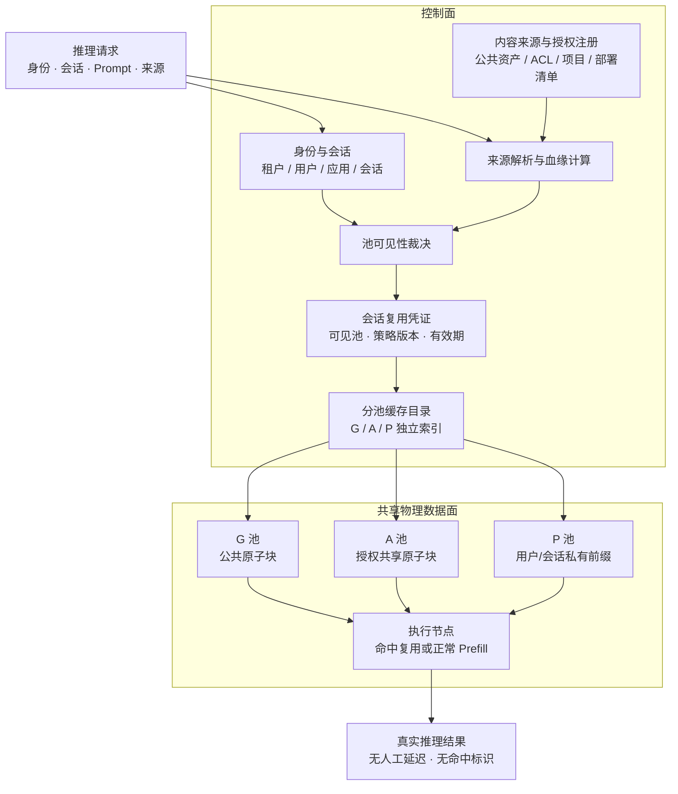
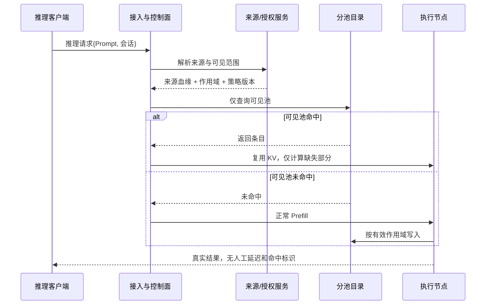

# 跨站点、跨租户/用户、跨会话 KV Cache 全局复用侧信道防护解决方案报告（更新版 V2）

**方案名称**：三级可见性缓存 + 原子块匹配 + 来源准入（Three-Pool Scoped Cache with Atomic Block Matching，TPC-ABM）

**文档日期**：2026-11-11

**版本说明（V2.1）**：本版替代 V1《跨站点跨租户跨会话 KV Cache 全局复用侧信道防护解决方案报告》，并在 V2 基础上吸收《Gemini方案评审与V2对比分析报告》中的合理部分。V2.1 的主要变更：

1. 明确 `parent_commitment` 是上下文链完整性锚点，不承担保密职责；
2. 增加分池动态配额与驱逐隔离，明确其属于可用性增强而非隐私主防线；
3. 增加授权凭证的 TTL、撤销传播和跨站重签约束；
4. 修正错误响应“相近时延”的表述，避免重新引入延迟补齐；
5. 将块级时延突变、跨会话加速持续性等列为残余可观测性与红队测试项，不作为产品外部特征。

V2 的主要更新：

1. 引入 Qwen 方案中“块级匹配”的有效思想，并将其升级为加密作用域内的内容定义原子块；
2. 废弃 V1 中偏重“单一域密钥”的表述，改为“缓存池可见性隔离为主、作用域密钥为辅”；
3. 明确 G/A/P 三池结构，解决同租户不同用户、跨会话、跨租户共享的边界问题；
4. 增加发布/授权时预热、跨站点复制策略、外部旁路治理和可验证的安全指标；
5. 明确指出无法安全保留的复用收益，不再承诺“任意私有内容全局复用 + 零延迟 + 彻底安全”。

---

## 背景：KV Cache CDN 方案概述

### 要解决的问题

大语言模型处理长上下文时，Prefill 阶段需要为全部输入 Token 生成 Key/Value 缓存（KV Cache），Decode 阶段再基于这些缓存逐 Token 生成结果。问题在于：

- **重复 Prefill 成本高**：不同用户、不同请求经常共享相同的 System Prompt、工具定义、RAG 文档或对话前缀，却各自重复计算；
- **长上下文首字延迟高**：上下文越长，Prefill 越慢，TTFT 从毫秒级升至秒级甚至更高；
- **单集群复用存在三重边界**：显存容量限制、LRU 驱逐导致“计算—驱逐—再计算”、不同集群之间无法共享已算好的 KV；
- **广域网直接拉取代价高**：完整 KV 体量可达数十 GB，在普通 WAN 带宽下实时拉取可能比本地重算更慢。

因此，KV Cache 已不再只是推理引擎内部的临时张量，而逐渐成为需要跨节点、跨地域调度的“可复用推理资产”。

### 基本解决思路

KV Cache CDN 的核心思路是：**把 KV Cache 当作内容寻址、可独立寻址与复用的对象，通过“中心生产—全局调度—边缘消费”的分层架构解决显存墙、地理墙和广域复用问题。**

主要手段包括：

1. **分层部署**：中心 Prefill 节点负责生产 KV；区域 POP 驻留温数据；边缘节点负责就近 Decode 和轻量增量 Prefill；
2. **全局目录与网关**：维护 KV 段的位置索引，负责亲和性路由、分发决策与降级仲裁；
3. **内容寻址与分段复用**：按模型兼容性信息和内容指纹标识 KV 段，将完整上下文拆成可独立复用的模块，支持公共前缀、工具定义、RAG 文档等不同粒度的复用；
4. **请求找数据**：优先将请求路由到已持有相关 KV 的节点，用 KB 级目录查询替代 GB 级跨域传输；
5. **异步预分发与增量计算**：在网络低谷把高共享 KV 预分发到边缘，请求命中后只对缺失部分执行增量 Prefill；
6. **经济与 SLA 博弈**：在跨域拉取、本地重算、中心接管之间按 SLA 和成本动态选择，避免广域拥塞导致体验崩溃。

上述架构可以显著减少重复 Prefill、降低长上下文 TTFT，并提升跨区域的算力复用率。

### 与本报告的关系

KV Cache CDN 解决了“如何跨站点、跨租户/用户、跨会话复用 KV”的问题，但也引入了一个新的安全前提：**KV 一旦全局共享，缓存命中/未命中的时间差就可能成为多租户侧信道。**

本报告在 KV Cache CDN 的整体背景下，重点解决该共享架构带来的时序侧信道问题：通过 G/A/P 三级可见性缓存、原子块匹配、来源准入和外部旁路治理，在保留公共与授权共享复用收益的同时，阻止攻击者通过响应时间推断他人私有前缀。

---

## 0. 执行摘要

### 0.1 方案一句话

> 将全局 KV Cache 拆为公共 G 池、授权共享 A 池和用户/会话私有 P 池；请求只查询自身可见的池；G/A 池只接受完整原子块命中，P 池保留 Token 级前缀复用；共享内容由发布/授权事件预热，未知来源默认私有；不注入延迟、不重算已有 KV、不返回伪造结果。

### 0.2 本方案解决的攻击

在跨站点、跨租户/用户、跨会话复用 KV Cache 时，攻击者可以通过逐 Token 构造候选前缀并测量命中/未命中时延，逐步恢复他人的私有前缀、RAG 文档、System Prompt 或对话历史。

攻击成立依赖以下条件：

```text
攻击者可控构造候选前缀
    + 受害者和攻击者进入同一缓存匹配空间
    + 系统提供 Token 级细粒度命中反馈
    + 命中/未命中存在可测时间差
    + 攻击者能迭代推断
```

本方案直接切断其中最有效的两个环节：

1. **共享性**：私有内容不进入攻击者可查询的池；
2. **细粒度反馈**：对外共享池只处理完整原子块，不提供 Token 级命中信号。

不采用：

- 全局延迟注入；
- 命中后重新完整 Prefill；
- 随机延迟/噪声；
- 返回伪造数据；
- 仅依赖异常检测；
- 用访问热度自动公开内容。

### 0.3 三个核心目标

| 目标 | 本方案实现方式 |
|---|---|
| 保持全局复用优势 | 公共内容全局复用，授权内容跨用户/租户/站点复用，个人内容跨会话复用 |
| 正常体验不劣化 | 命中路径不增加人工等待；私有用户缓存保留 Token 级加速；未命中按正常路径执行 |
| 不依赖用户配合 | 复用范围由身份、ACL、部署清单、RAG 来源自动确定；未知内容默认私有 |

---

## 1. 问题与威胁模型

### 1.1 需要保护的资产

1. 其他用户/租户的私有 Prompt 前缀；
2. 私有 RAG 文档、System Prompt、工具返回结果；
3. 对话历史与会话上下文；
4. “某文档/某前缀存在”或“某用户使用过某主题”的成员关系事实；
5. 共享内容的访问活动痕迹。

### 1.2 攻击者

| 类型 | 描述 |
|---|---|
| 跨租户攻击者 | 可调用推理 API，构造候选前缀探测其他租户内容 |
| 同租户其他用户 | 与受害者同一企业，但不属于同一用户/部门/项目 |
| 分布式探测群 | 多个账号/会话低慢速探测，规避单账号限流 |
| 已获授权但恶意的成员 | 可访问共享文档，但不应窥探其他成员的用户级私有后缀 |

### 1.3 可观测信道

| 信道 | 形式 |
|---|---|
| 主时信道 | TTFT、首 Token 到达间隔、总响应时间 |
| 路由信道 | 实际缓存节点、Endpoint 变化、跨站拉取行为 |
| 错误信道 | 未命中、无权限、文档不存在返回不同响应 |
| 计费信道 | 命中 Token 折扣、资源用量、账单 |
| 指标信道 | 缓存命中率、命中 Token 数、节点负载等暴露指标 |
| 目录信道 | 可枚举的全局前缀指纹或块索引 |
| 资源信道 | 缓存驱逐、队列优先级、Batch 调度差异 |

### 1.4 防御边界

以下问题不由本方案单独解决：

- 攻击者已经控制受害者同一账号；
- 平台内部管理员或缓存节点被攻破；
- 功耗、电磁、物理共享硬件等侧信道；
- 公共内容本身的冷热状态；
- 管理员错误地把私有内容登记为公共内容。

这些需要结合账号安全、TEE、密钥封装、审计和管理流程。

---

## 2. 为什么不能靠延迟与混淆解决

### 2.1 不可回避的技术边界

假设攻击者和受害者共享同一份缓存、攻击者可以提交任意候选前缀、命中显著快于未命中，且系统不增加延迟、不重算命中内容、不等待至未命中耗时，同时立即返回正确结果：

> 攻击者必然可以通过时间差判断候选前缀是否命中。

因此，以下三个目标不能同时对任意私有内容成立：

1. 任意私有内容跨租户复用；
2. 命中不增加延迟；
3. 缓存状态完全不可观测。

本方案不试图用噪声掩盖这一差异，而是让攻击者无法访问受害者缓存状态。

### 2.2 随机延迟为何不能作为主防线

- 攻击者可对同一候选重复采样；
- 正确候选命中概率更高，长期仍可统计分离；
- 要掩盖数秒级 Miss，需增加接近数秒的延迟，直接破坏体验；
- 分布式攻击可摊销采样成本。

随机化可作为流量整形，不作为隐私安全边界。

### 2.3 全量影子计算为何不可接受

命中时仍执行完整 Prefill，可以让时间一致，但：

- 失去 KV 复用的主要算力收益；
- 失去长上下文首字延迟收益；
- 与跨站点 CDN 的建设目的冲突。

因此本方案不采用恒定执行作为默认策略；只对极少数高敏业务作为可选策略。

---

## 3. 总体架构

### 3.1 三池结构

```text
G 池：公共原子块池（Global Atomic Pool）
    - 只接收有可审计公共来源的内容
    - 跨站点、跨租户、跨会话复用
    - 只接受完整原子块匹配
    - 内容发布/更新时后台预热

A 池：授权共享池（Audience Pool）
    - 只接收有 ACL/项目/部署授权的内容
    - 在授权主体集合内跨用户、跨租户、跨站点复用
    - 只接受完整原子块匹配
    - 授权关系建立时预热

P 池：私有池（Principal/Session Pool）
    - 接收用户输入、对话历史、个人上下文
    - 支持 Token 级前缀缓存
    - 只在同一最终用户或同一会话内可见
    - 不进入 G/A 池，除非后续获得可审计共享来源
```

三池物理上共享同一套缓存节点、内存、存储、传输和调度设施；逻辑上各自拥有独立的目录、索引键和可见性规则。

### 3.2 架构图



### 3.3 与 A/B/C/D 上下文模块的映射

| 模块 | 类型 | 默认池 |
|---|---|---|
| A：平台 System Prompt | 公共/部署资产 | G 或 A |
| B：标准工具定义与模板 | 公共/业务线资产 | G 或 A |
| C：租户/项目共享 RAG 文档 | 授权共享资产 | A；无共享授权时 P |
| D：用户对话历史 | 交互状态 | P |
| 未识别来源的原始 Prompt | 交互状态 | P |

关键规则：

> 一个包含 A+B+C+D 的完整前缀，其 KV 可见范围由所有上游来源中最严格者决定。包含用户 D 之后生成的 KV，不能进入 G/A 池。

---

## 4. G 池：公共原子块池

### 4.1 准入

G 池只接受可审计公共来源：

1. 平台签名发布的 System Prompt、工具 Schema、Agent 模板；
2. 明确登记为 public 的 RAG 对象或知识库；
3. 拥有开放许可证的公共语料；
4. 企业明确发布为全员可见的共享资产；
5. 运营商登记并审核的公共模板库。

规则：

- 访问次数、租户数量、会话数量**不能单独**将内容提升为公共；
- 语义相似、Embedding 聚类不能扩大共享范围；
- 敏感实体扫描只能收紧范围，不能扩大范围；
- 公共登记必须可审计、可撤回。

### 4.2 匹配

- 只接受完整原子块；
- 不保存可被任意请求者枚举的 Token 级全局前缀索引；
- 对短于最小块长的公共片段，可保留在 P 池或按业务授权处理，不进入 G 池。

### 4.3 预热

- 内容发布、更新、批准时生成或更新 KV 块；
- 按站点热度异步复制；
- 不把“第一个请求到达”作为唯一填充触发条件；
- 可降低首次访问 TTFT，并减少“某用户首次使用”作为缓存存在信号。

---

## 5. A 池：授权共享池

### 5.1 准入

A 池接受具有明确共享授权的内容：

- 企业/部门/工作区共享文档；
- 项目成员共享资料；
- 跨部门、跨租户合作项目文档；
- 企业部署共享提示词与工具模板；
- 经管理员批准的共享知识库。

授权主体集合由现有系统自动读取：

```text
Audience(doc) = ACL/项目成员/部门成员/共享组
```

### 5.2 跨主体复用

A 池支持：

- 同一授权组内跨用户复用；
- 同一授权组内跨会话复用；
- 同一授权组内跨站点复用；
- 跨租户合作项目中，授权成员跨租户复用。

### 5.3 私有后缀不得升格

如果一个前缀由：

```text
[A：共享 System Prompt]
  + [C：项目共享文档]
    + [D：用户甲私有提问]
```

组成，则包含 D 的 KV 作用域为：

```text
Audience(A) ∩ Audience(C) ∩ Principal(用户甲)
= 用户甲
```

即：

> **共享文档可以复用，用户私有后缀不能通过“挂靠”共享文档进入 A 池。**

### 5.4 授权撤销

- 授权变化提升策略版本；
- 旧版本缓存条目对新请求不可见；
- 被撤销成员无法再通过旧缓存键访问；
- 后台执行隔离、删除或重新封装；
- 不因元数据变化而无必要地重新计算 KV。

---

## 6. P 池：用户/会话私有池

### 6.1 作用

P 池承担：

- 用户即时输入；
- 多轮对话历史；
- Agent 中间状态；
- 个人知识库；
- 来源不明 Prompt；
- 短于最小块长的私有片段。

### 6.2 复用范围

| 身份识别情况 | P 池范围 |
|---|---|
| 可识别最终用户 | 用户级，支持同一用户跨会话 |
| 仅可识别企业 API Key | 会话级，避免企业内不同最终用户混用 |
| 无稳定身份 | 请求级或短生命周期会话 |
| 无法确认来源 | 用户/会话级，默认私有 |

### 6.3 匹配方式

- 保留 Token 级前缀缓存；
- 支持同一用户多轮对话、跨会话的快速复用；
- 其他用户/会话不能查询该索引；
- 索引键使用用户/会话作用域派生，不保存可全局枚举明文。

### 6.4 为什么 P 池仍保留 Token 级匹配

攻击者在自己 P 池中逐 Token 探测，只能命中自己写过的内容，无法获得受害者状态。因此无需牺牲同一用户体验去实施块级粗化。

---

## 7. 原子块设计

### 7.1 适用对象

仅 G/A 池强制完整原子块匹配。

P 池：

- 保持 Token 级前缀；
- 不对外暴露；
- 不与 G/A 池共享索引。

### 7.2 内容定义分块

建议对规范化 Token 序列进行内容定义分块（CDC）：

```text
使用滚动哈希确定块边界
最小块长 B_min 可配置
块大小在有界范围内变化
块键 = Hash/HMAC(scope || model_manifest || block_tokens || parent_commitment)
```

优点：

1. 文档插入、删除、移位时边界较稳定；
2. 相同内容在不同位置产生可对齐的块；
3. 攻击者无法通过添加前缀轻易改变块边界以制造 Token 级 oracle；
4. 适合 RAG/共享文档的完整段落复用。

**父块承诺的作用与边界**：

- `parent_commitment` 将块绑定到其上游上下文链与位置依赖，用于防止不同上下文中的块被错误拼接、跨站迁移时被投毒替换，以及上游依赖缺失时错误复用下游 KV；
- 它属于**完整性与正确性机制**，不承担保密职责：攻击者若已知道完整父链，仍可计算正确的父块承诺，不能因此获得保密性保护；
- 它不能替代 G/A/P 作用域隔离；跨租户/跨用户保密性仍由“未授权请求不查询受害者池”保证；
- 包含父块承诺会降低同一文档片段在不同父链下的复用率，这是正确性优先的取舍。若业务确需跨父链复用，应通过独立的位置兼容性处理或经审计的复用模式实现，不能默认放开。

### 7.3 完整块约束

```text
G/A 查询：
    完整块命中 → 允许复用
    半块、块内部分前缀、仅前面若干 Token → 不允许命中
    禁止为了提升命中率回退到 Token 级全局匹配
```

最后一个不完整块：

- 留在 P 池；
- 或等待后续请求补全后再进入 A 池；
- 不因半块命中向请求者提供全局反馈。

### 7.4 块长权衡

| 块长 | 抗探测 | 合法复用 | 说明 |
|---|---|---|---|
| 小 | 较弱 | 更好 | 块尾单 Token 预测更容易 |
| 大 | 更强 | 部分复用减少 | 需要真实文档完整段落才命中 |

`B_min` 需要按工作负载、文档长度、公共模板长度、RAG chunk 分布校准，不应拍脑袋固定。

### 7.5 原子块的残余风险

原子块不是绝对安全，仍有以下残余：

- 攻击者已知块前 B−1 个 Token 时，可能测试最后 1 个 Token；
- 攻击者已经知道完整块时，仍可进行成员关系测试；
- 目录泄露后可能尝试枚举块；
- 共享池的块级时延突变、块命中率变化等仍可能被授权用户观测，属于残余可观测性，不得将其作为对外特征或安全卖点。

因此：

- 私有块不进入 G/A；
- A 池的成员关系仅对授权组可见；
- 目录块索引使用作用域密钥；
- 跨池禁止回退到 Token 级全局索引。

---

## 8. 来源解析与可见范围判定

### 8.1 来源解析

来源可由以下方式确定：

1. RAG 编排层直接提供文档 ID；
2. Agent 框架提供 System Prompt/工具包 ID；
3. 应用提供稳定资产 ID；
4. 对拼接 Prompt，按已登记公共模板做精确 Token 前缀匹配；
5. 对无法识别部分，默认归属当前用户/会话。

禁止：

- 使用语义相似度将内容归入公共池；
- 使用访问热度推动跨租户共享；
- 使用敏感实体识别扩大共享范围。

### 8.2 可见范围计算

每个来源具有：

```text
SourceScope =
    Public
  | Audience(allowed_subject_set, policy_epoch)
  | Principal(user)
  | Session(session)
```

任意前缀的作用域：

```text
EffectiveScope(prefix)
    = ⋂ EffectiveScope(source_i)
```

即取最严格的交集。

### 8.3 示例

| 上下文 | 有效作用域 | 进入池 |
|---|---|---|
| 公共 System Prompt | Public | G |
| 公共工具模板 | Public | G |
| 部门共享文档 | 部门 Audience | A |
| 公共 A + 部门 C | 部门 Audience | A |
| 部门 C + 用户甲提问 D | 用户甲 | P |
| 仅用户甲私有资料 | 用户甲 | P |
| 来源不明 Prompt | 当前用户或会话 | P |

### 8.4 无用户配合如何实现

- 用户不需要填写任何隐私等级；
- 应用不需要逐请求传标签；
- 复用范围由现有身份、ACL、部署清单和内容来源推导；
- 无法识别的部分自动采用最小可见范围；
- 管理员/内容发布者的公共登记是系统现有流程，不是普通用户逐请求操作。

---

## 9. 缓存键与目录

### 9.1 索引键

```text
GKey = Hash(model_manifest || block_tokens)

AKey = HMAC(
    AudienceKey,
    model_manifest || block_tokens || policy_epoch
)

PKey = HMAC(
    PrincipalKey或SessionKey,
    model_manifest || token_prefix || policy_epoch
)
```

### 9.2 目录隔离

- G/A/P 目录逻辑分区；
- 请求凭证中只包含其可见池和可见作用域；
- 目录查询接口不接受“任意作用域探测”；
- 未授权空间不进入查询路径；
- 对外不返回块是否存在、命中段数、缓存节点。

### 9.3 缓存条目元数据

```text
CacheEntry {
    pool_type,                 // G / A / P
    model_manifest_hash,
    prefix_or_block_commitment,
    parent_commitment,
    source_lineage_hash,
    effective_scope,
    policy_epoch,
    encryption_key_reference,
    site_locations,
    lifecycle_state
}
```

目录中不保存可直接公开检索的明文 Prompt。

### 9.4 授权凭证

会话建立时生成：

```text
CacheViewTicket {
    identity,
    allowed_public,
    allowed_principals,
    allowed_audiences,
    issued_at,
    policy_epoch,
    expiration,
    revocation_epoch,
    signature
}
```

请求路径只需本地校验凭证和策略版本，避免每次访问中央 IAM/ACL 数据库。

凭证不能长期固化，必须满足以下约束：

- **有限有效期**：`expiration` 到期必须重新签发；
- **撤销传播**：ACL 变更、用户被移出项目/部门、授权组调整、策略版本升级时必须使旧凭证失效；
- **跨站重签**：用户跨站点迁移或会话恢复时重新校验并签发；
- **本地校验不等于取消撤销**：本地验签只减少查询频率，不能替代可信撤销列表或策略版本源；
- **旧条目隔离**：撤权后旧缓存条目不可被新请求访问，后台再执行删除或重新封装。

---

## 10. 请求处理流程

### 10.1 处理步骤

```text
1. 认证请求，得到租户/用户/应用/会话身份。
2. 解析上下文来源，建立前缀血缘。
3. 计算每个前缀的有效作用域。
4. 与 CacheViewTicket 比较，确定可查询的池。
5. 按池执行查询：
   - P：Token 级本用户/会话前缀；
   - A：授权作用域内完整原子块；
   - G：完整公共原子块。
6. 命中：复用已有 KV，仅计算缺失部分。
7. 未命中：正常 Prefill，无人工延迟。
8. 新 KV 按有效作用域写入对应池。
9. 返回真实结果，不暴露命中信息。
```

### 10.2 伪代码

```text
function handle_request(request):
    identity = authenticate(request)
    lineage = resolve_sources(request.prompt, request.context)
    ticket = get_or_build_cache_view_ticket(identity)

    for prefix in decompose_with_lineage(request.prompt, lineage):
        scope = intersect_scopes(prefix.sources)

        if not ticket.allows(scope):
            continue

        if scope is Public:
            entry = lookup_G(complete_atomic_blocks(prefix))
        else if scope is Audience and ticket.allows(scope):
            entry = lookup_A(complete_atomic_blocks(prefix), scope)
        else if scope is Principal/Session:
            entry = lookup_P(token_prefix(prefix), scope)

        if entry is valid and entry.policy_epoch == ticket.policy_epoch:
            reuse(entry)
        else:
            normal_prefill(prefix)
            insert_by_effective_scope(prefix, scope)

    return real_inference_result()
```

### 10.3 请求时序



---

## 11. 跨站点部署

### 11.1 物理共享、逻辑分池

- G 池：可按热度全局复制和预取；
- A 池：只在服务授权主体集合的站点复制或迁移；
- P 池：随用户会话加密迁移，或留在用户当前站点，不向其他用户提供索引。

### 11.2 跨站策略

| 池 | 复制策略 | 查询策略 |
|---|---|---|
| G | 全局预取/复制 | 任意站点可服务 |
| A | 授权主体所在站点/区域 | 仅授权请求可跨站拉取 |
| P | 用户会话迁移 | 仅同一用户/会话可访问 |

### 11.3 路由与地址

- 对客户端保持稳定推理入口；
- 内部执行缓存感知路由；
- 不返回实际缓存节点/AIOF 地址；
- 不因命中状态改变 Endpoint；
- 不通过响应头暴露跨站/本地命中差异。

### 11.4 授权与加密

- 跨站查询前验证 CacheViewTicket；
- A/P 缓存块加密存储与传输；
- 授权撤销后旧条目不可访问；
- 节点被攻破不直接暴露可枚举明文索引。

---

## 12. 正常体验与性能

### 12.1 不做的牺牲体验动作

- 不补固定延迟；
- 不重算命中的完整 KV；
- 不把命中请求拖入慢速 Batch；
- 不返回伪造 Token；
- 不做全局均一化等待。

### 12.2 各路径表现

| 路径 | 正常行为 |
|---|---|
| P 池命中 | 同用户多轮/跨会话快速复用 |
| G 池命中 | 公共内容直接复用 |
| A 池命中 | 授权共享内容直接复用 |
| 未命中 | 正常 Prefill，与无安全机制时一致 |
| 跨站命中 | 按原有经济性选择拉取/调度/重算 |

### 12.3 新增开销

- 来源解析；
- 血缘和作用域计算；
- 缓存键计算；
- 本地凭证和策略版本校验；
- 分池目录查询。

控制手段：

- 会话建立时生成 CacheViewTicket；
- 缓存来源解析结果；
- 索引按池分区；
- 公共快速路径使用简化查询；
- 授权票据本地验签。

### 12.4 复用损失

与无限制全局共享相比，本方案会损失：

> 无授权关系的两个租户/用户，碰巧输入相同私有内容时所可能获得的缓存复用。

这部分收益无法在“不增加延迟 + 不重算 + 不观察”的条件下安全保留。

仍可保留：

- 公共模板复用；
- 授权共享文档复用；
- 同一用户跨会话复用；
- 授权项目跨租户复用；
- 所有安全范围内的跨站复用。

### 12.5 分池配额与驱逐隔离

G/A/P 三池物理共享缓存设施，但必须配置独立容量配额，避免私有流量洪峰挤占公共与授权共享缓存：

- **最低保留**：G 池和 A 池设置最低保留比例，热点公共模板与授权文档不因 P 池洪峰被完全挤出；
- **P 池上限**：P 池按用户/租户设置容量上限，防止单个主体占满共享内存；
- **池间不迁移逻辑条目**：配额调整只影响容量分配，不允许把 P 池条目重新标记为 G/A 池，也不允许跨池“冷热置换”改变条目可见性；
- **调整滞回**：动态配额采用滞回和最小调整周期，避免频繁抖动；
- **内部指标**：配额占用、驱逐次数、池水位只对内部运维和审计可见，不对外暴露；
- **回收顺序**：容量压力下优先回收安全等级较低、已超配额或过期条目，保持 G/A 池的服务稳定性。

需要明确：

> 分池配额是**可用性、资源隔离和驱逐侧信道缓释**机制，不是隐私主防线；跨租户/跨用户保密性仍由 G/A/P 逻辑可见性隔离承担。

---

## 13. 外部旁路治理

### 13.1 响应

不返回：

- `cache_hit`；
- `hit_tokens`；
- `X-Cache-Node`；
- 实际 AIOF/缓存站点；
- “未命中”和“无权限”的细粒度差异。

### 13.2 路由

稳定入口，内部路由。若客户端直连，返回不随命中变化的虚拟入口，不暴露实际落点。

### 13.3 错误

对无权访问、资源不存在、未命中，采用统一响应结构和处理路径，避免存在性预言机；不承诺错误时延完全一致，不通过人为延迟补齐。必须先鉴权再查询，未授权请求不进入受害者缓存目录。

### 13.4 计费

- 对外按逻辑输入 Token 统一计价；
- 缓存节省只在内部成本分析体现；
- 用量报告按时间窗聚合；
- 不向普通用户暴露其他主体的缓存指标。

### 13.5 调度

- 不把命中状态作为对外 Batch 优先级；
- 不对“相似但不相同”的合法请求自动拖慢；
- 按 §12.5 配置分池容量配额，减少驱逐侧信道。

### 13.6 可观测性验证边界

块级时延突变、跨会话加速持续性、越权错误一致性等现象，可以作为内部红队验证和方案识别信号，但必须明确：

- 它们属于**残余可观测性**，不是产品对外特征，也不应作为安全卖点；
- 不得为了便于侵权取证而主动暴露块命中、块边界或跨会话加速状态；
- 红队测试应控制模型、负载、网络、批次和上下文长度等变量，避免把正常性能波动误判为块级信号；
- 黑盒时序只能作为辅助验证，不能单独证明内部实现，也不能单独作为专利侵权证据。

---

## 14. 攻击场景验证

### 14.1 场景一：跨租户私有 RAG 探测

```text
受害者：租户 A 私有文档 → P 池或 A 池（其授权组）
攻击者：租户 B，无授权
攻击者查询：G + 自己的 P + 自己获授权的 A
```

结果：

- 受害者私有块不在攻击者可查询池；
- 逐 Token 猜测只产生攻击者自己的缓存状态；
- 攻击者无法获得受害者 Token 是否正确的时间反馈。

### 14.2 场景二：同租户不同用户探测

```text
用户甲私有对话 → P(用户甲)
用户乙 → P(用户乙)
```

默认不建立“整个租户共享池”。只有企业发布的共享资产进入 A 池。用户乙不能通过缓存探测用户甲的私有对话。

### 14.3 场景三：项目共享文档

```text
项目 P 成员 → A(项目成员集合)
非成员 → 无 A 查询权
```

项目成员可以跨用户、跨租户、跨站点复用；非成员无法探测。

### 14.4 场景四：共享文档 + 私有续写

```text
共享文档 C + 用户甲私有 D
→ EffectiveScope = 用户甲
```

于是：

- C 可被授权成员复用；
- C+D 的 KV 只属于用户甲；
- 其他授权成员无法探测 D。

### 14.5 场景五：攻击者已知完整私有块

- 私有块不进入 G/A；
- 攻击者无授权，不查询受害者池；
- 无法通过目录探测块存在性；
- 授权成员若已知完整文档，则其本身已有文档权限，属于授权集合内部问题。

### 14.6 场景六：公共内容高频探测

- G 池公共内容不包含其他租户私有前缀；
- 命中公共块不泄露受害者私有内容；
- 高频请求按通用限流/配额治理，不通过拖慢正常公共请求解决隐私问题。

---

## 15. 总结

### 15.1 三个目标的回答

**如何保持全局可复用 KV Cache 优势？**

- 公共内容进入 G 池，全局复用；
- 授权文档进入 A 池，在授权组内跨用户/租户/站点复用；
- 用户私有内容进入 P 池，同一用户跨会话复用；
- 全局物理缓存、目录、站点和网络仍共享；
- 只放弃无授权私有内容的重复复用。

**如何保持正常用户体验不劣化？**

- 不增加固定延迟；
- 不重算命中的 KV；
- 不做全局均一化等待；
- 不返回伪造结果；
- P 池保留 Token 级前缀加速；
- G/A 池通过发布预热降低首次访问延迟。

**如何不依赖用户配合？**

- 复用范围来自身份、会话、ACL、项目成员、部署清单和 RAG 来源；
- 未识别内容默认私有；
- 不要求逐请求打标签；
- 公共性由可审计发布/登记决定；
- 不使用访问热度推断公共性。

### 15.2 一句话总结

> **公共内容进 G 池，授权内容进 A 池，私有交互进 P 池；请求只查可见池，共享池只认完整原子块；共享内容发布即预热；命中状态不出接口；未授权内容根本不进入查询路径。**
